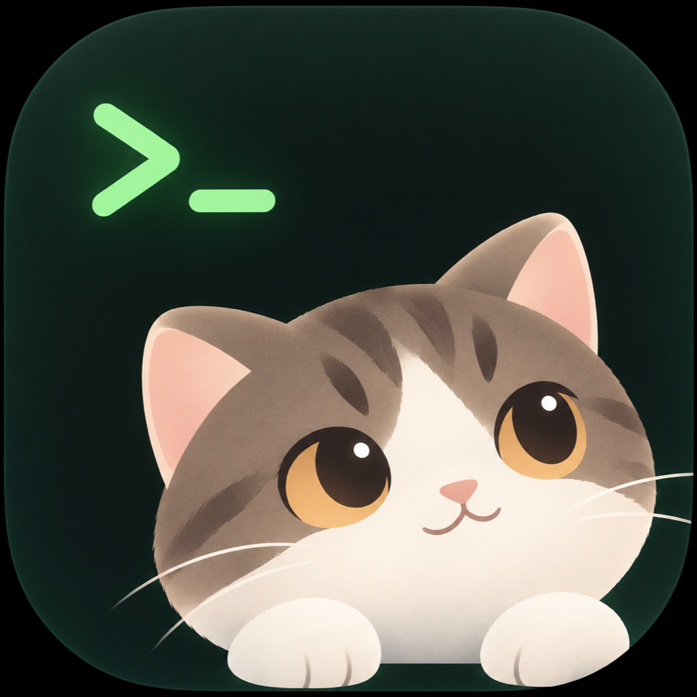
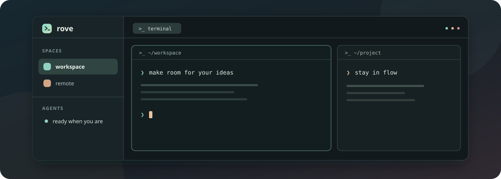

<div align="center">
  
  <h1>Rove</h1>
  <p><strong>A little more room for your terminals and agents.</strong></p>
  <p>A desktop workspace for local sessions, remote machines, and the work in between.</p>
  <p>
    <a href="https://github.com/TengYangTuoHai/rove/releases"><strong>Download</strong></a> ·
    <a href="#features">Features</a> ·
    <a href="#development">Development</a> ·
    <a href="README_CN.md">简体中文</a>
  </p>
  <p>
    <a href="https://github.com/TengYangTuoHai/rove/actions/workflows/build.yml"></a>
    <a href="LICENSE"></a>
    
  </p>
  
  <p><sub>Workspace illustration</sub></p>
</div>

Built with Go and [MyGo](https://github.com/egoist/mygo), Rove uses [herdr-core](https://github.com/herdrdev/herdr-core) to run terminals in the background. Close the window and your sessions keep running while the computer stays on.

## Features

**Make space to focus.** Organize work into spaces, tabs, and split panes. Resize, focus, or zoom panes and search terminal output and scrollback.

**Bring your machines together.** Connect over SSH and work with remote terminals, files, and Git changes alongside local sessions.

**Keep up with your agents.** See agent status, inspect background workers, and receive system notifications and optional sounds when an agent finishes or needs attention.

**Make it yours.** Customize themes, fonts, appearance, and shortcuts. Browse files, preview changes, create Git commits, and find actions in the command palette. The interface supports English, Simplified Chinese, Traditional Chinese, and Japanese.

## Install

Download a package for your system from [GitHub Releases](https://github.com/TengYangTuoHai/rove/releases):

| Platform | Supported architectures | Release package |
| --- | --- | --- |
| macOS | Apple silicon, Intel | `.dmg` |
| Windows | x86-64 | installer `.exe` |
| Linux | x86-64, ARM64 | `.deb` |

Release packages include the app, `herdr-core`, and the required native libraries. Linux users of other distributions can build a portable archive or an Arch package from source.

### macOS

The current macOS build is ad hoc signed and is not notarized. After installing Rove, macOS may block its first launch. If you trust the download, attempt to open it, then go to **System Settings → Privacy & Security → Open Anyway** and confirm. See [Apple's instructions](https://support.apple.com/en-us/102445) for details.

### Notifications

On macOS, system notifications require a packaged app or `go tool mygo dev`, and permission must be granted when requested. Linux uses `notify-send` (`libnotify-bin` on Debian/Ubuntu, `libnotify` on Fedora/Arch) in a graphical session. Windows uses native notifications; allow Rove in **Settings → System → Notifications** if needed.

## Development

Install Go 1.27.3 or later and [herdr-core](https://github.com/herdrdev/herdr-core#install), then run:

```sh
git clone https://github.com/TengYangTuoHai/rove.git
cd rove
go run .
```

Rove looks for its bundled core first, then `hc` or `herdr-core` on `PATH`, followed by the standard core installation locations. `go run .` and `go tool mygo dev` require an installed core unless a development bundle has been prepared.

Run the checks with:

```sh
go test ./...
go tool mygo i18n check
```

### Build packages

Build for a specific target:

```sh
go tool mygo build -platform darwin/arm64
```

Replace the platform with one of `darwin/amd64`, `windows/amd64`, `linux/arm64`, or `linux/amd64` as needed. To build all five targets:

```sh
./scripts/build-all.sh
```

Use Bash or Git Bash on Windows. Builds are written to `build/<os>-<arch>/`. The build hook downloads the pinned core releases, verifies their SHA-256 checksums, and stages them with the app. Builds need network access; download or verification errors stop packaging. The pinned release and checksums are in [cmd/prepare-hc/release.json](cmd/prepare-hc/release.json).

MyGo builds macOS `.app` bundles, Windows app directories, and Linux packages. DMG creation requires macOS; Windows installer creation requires NSIS (MyGo can install it automatically on Windows). On other hosts, install NSIS to generate Windows installers. Distribute the complete app directory or installer, including its `bin/` directory and native libraries; the Windows `.exe` alone is insufficient. Windows ARM64 is not supported by the bundled core releases.

### Configuration

Rove stores `settings.json`, `keys.json`, and `view.json` in `~/.config/rove` by default. Set `XDG_CONFIG_HOME` to use its `rove` subdirectory, or set `ROVE_HOME` to choose the configuration directory directly. Settings and shortcuts can be changed in the app.

| Action | macOS | Linux / Windows |
| --- | --- | --- |
| Command palette | `Cmd+Shift+P` | `Ctrl+Shift+P` |
| New space | `Cmd+N` | `Ctrl+Shift+N` |
| New tab | `Cmd+T` | `Ctrl+Shift+T` |
| Split right | `Cmd+D` | `Ctrl+Shift+O` |
| Split down | `Cmd+Shift+D` | `Ctrl+Shift+E` |
| Find in terminal | `Cmd+F` | `Ctrl+Shift+F` |
| Settings | `Cmd+,` | `Ctrl+,` |

### Translations

Message catalogs are in `internal/i18n/locales`. After changing them, regenerate the Go accessors and check the catalogs:

```sh
go tool mygo generate
go tool mygo i18n check
go test ./...
```

Include the updated `catalog_gen.go` when committing catalog changes.

## Releases

The [build workflow](.github/workflows/build.yml) tests and builds the five supported targets. A push to `master` publishes a development prerelease; a `v*` tag matching the version in `mygo.json` publishes a versioned release. Manual runs upload build artifacts without publishing a release.

The planned version is stored in `mygo.json` and can be updated with:

```sh
go run ./cmd/version
go run ./cmd/version bump patch
go run ./cmd/version set 0.2.0-rc.1
```

## License

Rove is licensed under the [MIT License](LICENSE). Third-party assets and dependencies retain their own licenses and notices.
